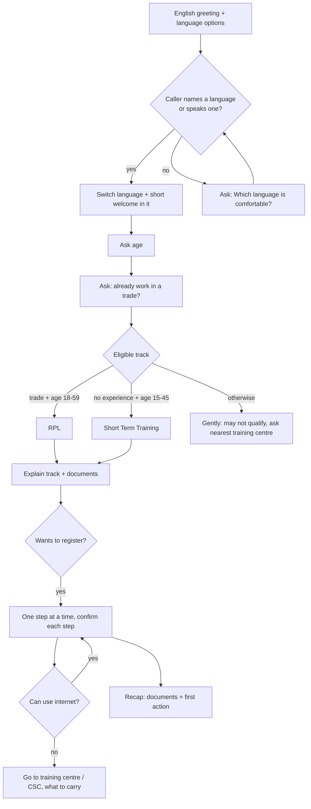

# Conversation flow

## Eligibility rules (PMKVY 4.0)
| Caller | Track |
|---|---|
| Works in a trade, age 18 to 59 | RPL: short test and bridge training, then a certificate |
| No experience, age 15 to 45 | Short Term Training (about 200 to 600 hours) |
| Outside these ranges | May not qualify; ask the nearest training centre |

The training centre always has the final say.

## Step-by-step guidance
- One step in one or two short sentences, then: "Did you do this? Shall I tell you the next step?"
- If stuck, the same step is re-explained in simpler words.
- Steps come from the knowledge base guide, never invented.
- Offline fallback: nearest training centre or Common Service Centre, and what to carry.

## Language rules
Default English. Switch with the **Change Output Language** tool. Stay in the chosen language for everything. Switch again whenever the caller asks.

## Safety rules
- Training is free; nobody should be paid for a seat, form or certificate.
- Never ask for or repeat Aadhaar number, bank details, OTP or PIN.
- No promises about jobs or payments.
- Only give links found in the knowledge base; say them slowly and offer to repeat.
- Stay on government schemes.

## Known quirk
The agent sometimes re-confirms a fact the caller just stated (for example "are you still working as a tailor?"). Harmless, but it can be removed with the prompt line in [demo.md](demo.md).
